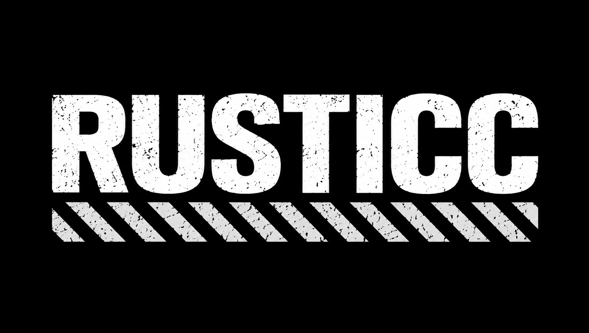

# Rusticc



Rusticc is [COSMOS](https://github.com/OpenCentauri/cosmos) (OpenCentauri's firmware for the Elegoo Centauri Carbon
family) in Rust: the same distribution, with its Kalico replaced by [kaliru](https://github.com/Rusti3D/kaliru)
(Kalico ported to Rust), its Moonraker by [Moonruster](https://github.com/Rusti3D/moonruster) (Moonraker ported to
Rust), and its MCU firmware by kaliru's Rust firmware. The first goal is parity with COSMOS: same
behaviour, less CPU and memory.

COSMOS builds Kalico and Moonraker with its own patch sets; Rusticc builds kaliru and Moonruster with its own the
same way. kaliru and Moonruster stay plain ports of their originals, and everything Rusticc-specific lives here.

## Using Rusticc on a printer

Rusticc installs like a COSMOS update: an `.swu` image, written to the printer's inactive A/B slot, active from
the next reboot. Everything you configured stays: `printer.cfg`, `cosmos.conf`, your plugins (AFC, ACE, ...),
macros and the COSMOS slicer profiles all work unchanged, because Rusticc keeps COSMOS's configuration, file
layout and macro names.

- **Install** from a COSMOS printer's shell: copy the image over and run COSMOS's installer, then reboot:
  ```sh
  flash /user-resource/rusticc-cc1.swu   # writes the other slot; "Update finished, run 'reboot'"
  reboot
  ```
  At the first boot the bed and toolhead boards are flashed with Rusticc's MCU firmware (the same check COSMOS
  uses: their firmware version differs); the mainboard DSP loads Rusticc's firmware from the image.
- **Check what runs:** the login banner and `/etc/os-release` say Rusticc; `klippy.log` starts with
  `App Name: Rusticc`; Mainsail shows the Rusticc version (Rusticc ships Mainsail and GrumpyScreen only:
  no Fluidd, AtomScreen or Doom).
- **Updates:** the web UI's update manager and `check-update` look at github.com/Rusti3D/rusticc releases
  (`check_for_updates` in `cosmos.conf` turns this off).
- **Going back to COSMOS:** install a COSMOS `.swu` the same way (`flash cosmos-centauri-carbon-1.swu`); its first
  boot flashes COSMOS's MCU firmware back. The previous slot can also be booted directly:
  `fw_setenv mmc_root /dev/mmcblk0p5; fw_setenv boot_part 4; fw_setenv systemAB_next A; reboot` (slot A; for slot B
  use `/dev/mmcblk0p8`, `7`, `B`).

## Layout

| | |
|---|---|
| `cosmos/` | COSMOS (submodule, pinned), with its own submodules (poky, meta-oe, meta-sunxi, ...) |
| `meta-rusticc/` | the Yocto layer on top of COSMOS's meta-opencentauri: only what differs |
| `meta-rusticc/recipes-apps/rusticc/` | Rusticc's klippy: kaliru + `files/kaliru/*.patch` (Rusticc's patches) |
| `meta-rusticc/recipes-apps/moonruster/` | Moonruster (Moonraker in Rust) with Rusticc's patches, in place of COSMOS's Moonraker |
| `meta-rusticc/recipes-apps/klipper/` | COSMOS's klipper service running Rusticc; the MCU firmware swapped for kaliru-mcu (prebuilt in `files/rusticc-firmware`) |
| `meta-rusticc/recipes-*/` | branding: boot logo, splash, Fluidd theme, login banner, distro name |
| `branding/` | `Rusticc.png` and `make_assets.py`, which makes every image the layer uses |
| `tools/` | the patch workflow, the firmware build, the parity checks against COSMOS |
| `deploy/` | trying Rusticc by hand on a printer running COSMOS (nothing is changed for the next boot) |
| `cases/`, `dicts/`, `docs/`, `reference-patches/` | parity test cases, the CC1's MCU dictionaries, the COSMOS audit, the reference build |

## Building an image

As COSMOS (`cosmos/Development.md`: host packages, then bitbake), from this repository:

```sh
git clone --recurse-submodules https://github.com/Rusti3D/rusticc.git
cd rusticc
. ./rusticc-init-build-env          # build/, with meta-rusticc and DISTRO = "rusticc"
bitbake cosmos-image-usb            # or cosmos-image-mmc / cosmos (the update image); MACHINE=centauri-carbon-2 for the CC2
```

## Working on Rusticc's kaliru patches

```sh
tools/kaliru-tree.sh                 # work/kaliru: kaliru at the recipe's SRCREV + the patches as commits
# edit, build, test, commit in work/kaliru
tools/kaliru-export.sh               # back into meta-rusticc/recipes-apps/rusticc/files/kaliru + rusticc-patches.inc
tools/build_firmware.sh              # the MCU images, after firmware changes
python3 tools/gen_crates_inc.py work/kaliru > meta-rusticc/recipes-apps/rusticc/rusticc-crates.inc   # after Cargo.lock changes
```

The MCU firmware is built outside Yocto (Yocto's Rust has no bare-metal targets; the HiFi4 DSP needs Espressif's
Xtensa Rust and COSMOS's Zephyr gcc to link: see `tools/build_firmware.sh`).

## Parity checks

- `tools/ref_setup.sh` builds the reference (Kalico + COSMOS's patches, `~/rk/cosmos_ref`); `tools/case_cmp.sh`
  runs test cases against it and against Rusticc; `tools/cc1_cmp.sh` runs a CC1 configuration with the printer's MCU
  dictionaries.
- Firmware: `tools/mkref_cosmos.sh` builds COSMOS's C firmware; kaliru's `firmware/tests/ctr_check.sh` and
  `emu_cmp.sh` compare the Rust build with it (all eight COSMOS boards: identical requests and dictionaries).

## Status

See `docs/STATUS.md`.
